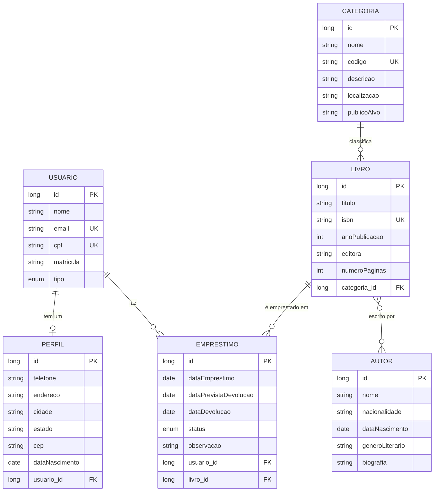

# Modelo de dados

A API tem **6 entidades**, **3 relacionamentos de cada tipo** exigido (um-para-um, um-para-muitos e muitos-para-muitos) e **2 enums em uso**. O banco é o H2 em memória: as tabelas são criadas ao iniciar a API e apagadas ao encerrar (`ddl-auto=create-drop`).

## Diagrama

A tabela de ligação `livro_autor` guarda o relacionamento muitos-para-muitos entre livros e autores.

## Relacionamentos

| Tipo | Entidades | Detalhe |
|---|---|---|
| Um-para-um | Usuário ↔ Perfil | Cada usuário tem no máximo um perfil. Excluir o usuário exclui o perfil |
| Um-para-muitos | Categoria → Livros | Todo livro pertence a uma categoria |
| Um-para-muitos | Usuário → Empréstimos | |
| Um-para-muitos | Livro → Empréstimos | O histórico do livro |
| Muitos-para-muitos | Livro ↔ Autores | Um livro pode ter vários autores e um autor, vários livros |

## Campos

`*` = obrigatório. Os limites de tamanho são em caracteres. Todas as entidades têm um `id` gerado pela API.

### Usuário

| Campo | Tipo | Regras |
|---|---|---|
| nome * | texto | até 100 |
| email * | texto | formato de e-mail, até 150, **único** |
| cpf * | texto | exatamente 11 dígitos, sem pontos ou traço, **único** |
| matricula | texto | até 20 |
| tipo * | enum | `ALUNO`, `PROFESSOR`, `FUNCIONARIO` ou `VISITANTE` |

### Perfil

| Campo | Tipo | Regras |
|---|---|---|
| telefone * | texto | até 20 |
| endereco * | texto | até 200 |
| cidade * | texto | até 80 |
| estado * | texto | sigla com 2 letras maiúsculas (ex.: `SP`) |
| cep * | texto | exatamente 8 dígitos, sem traço |
| dataNascimento * | data | |
| usuarioId * | número | ID de um usuário existente que ainda não tem perfil (só na entrada; na saída vem o objeto `usuario`) |

### Autor

| Campo | Tipo | Regras |
|---|---|---|
| nome * | texto | até 100 |
| nacionalidade * | texto | até 60 |
| dataNascimento | data | precisa estar no passado |
| generoLiterario | texto | até 60 |
| biografia | texto | até 1000 |

### Categoria

| Campo | Tipo | Regras |
|---|---|---|
| nome * | texto | até 80 |
| codigo * | texto | até 10, **único** (ex.: `ROM`) |
| descricao | texto | até 255 |
| localizacao | texto | até 50 (ex.: `Estante A`) |
| publicoAlvo | texto | até 50 |

### Livro

| Campo | Tipo | Regras |
|---|---|---|
| titulo * | texto | até 150 |
| isbn * | texto | até 20, **único** |
| anoPublicacao * | número | maior ou igual a 1 |
| editora * | texto | até 100 |
| numeroPaginas * | número | maior ou igual a 1 |
| categoriaId * | número | ID de uma categoria existente |
| autoresIds | lista de números | IDs de autores existentes (pode ficar vazia) |

### Empréstimo

| Campo | Tipo | Regras |
|---|---|---|
| dataEmprestimo * | data | |
| dataPrevistaDevolucao * | data | |
| dataDevolucao | data | preencha quando o livro for devolvido |
| status * | enum | `ATIVO`, `DEVOLVIDO` ou `ATRASADO` |
| observacao | texto | até 255 |
| usuarioId * | número | ID de um usuário existente |
| livroId * | número | ID de um livro existente |

## Enums

| Enum | Valores | Usado em |
|---|---|---|
| `StatusEmprestimo` | `ATIVO` (ainda emprestado), `DEVOLVIDO`, `ATRASADO` (passou do prazo) | Empréstimo |
| `TipoUsuario` | `ALUNO`, `PROFESSOR`, `FUNCIONARIO`, `VISITANTE` | Usuário |

O status **não muda sozinho** com o passar do tempo: quem registra o empréstimo escolhe o valor. (O enum `StatusLivro` existe no código, mas nenhuma entidade o usa.)

## Regras de exclusão

| Ao excluir... | Se houver... | Resultado |
|---|---|---|
| Categoria | livros | **409**, exclua os livros antes |
| Autor | livros | **409** |
| Livro | empréstimos | **409** |
| Usuário | empréstimos | **409** |
| Usuário | só o perfil | exclui o usuário **e** o perfil |
| Empréstimo, perfil | — | exclui normalmente |

Ordem para limpar tudo: empréstimos → livros → autores e categorias → usuários.
